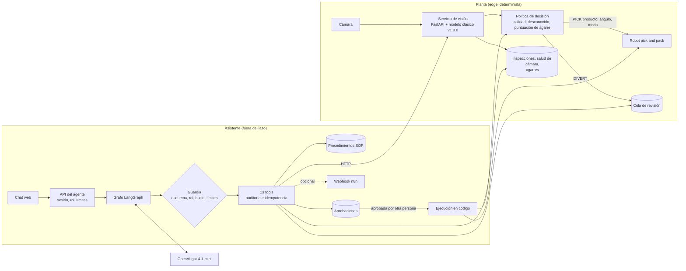
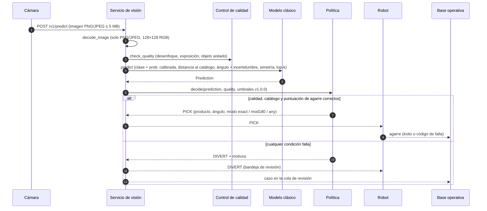
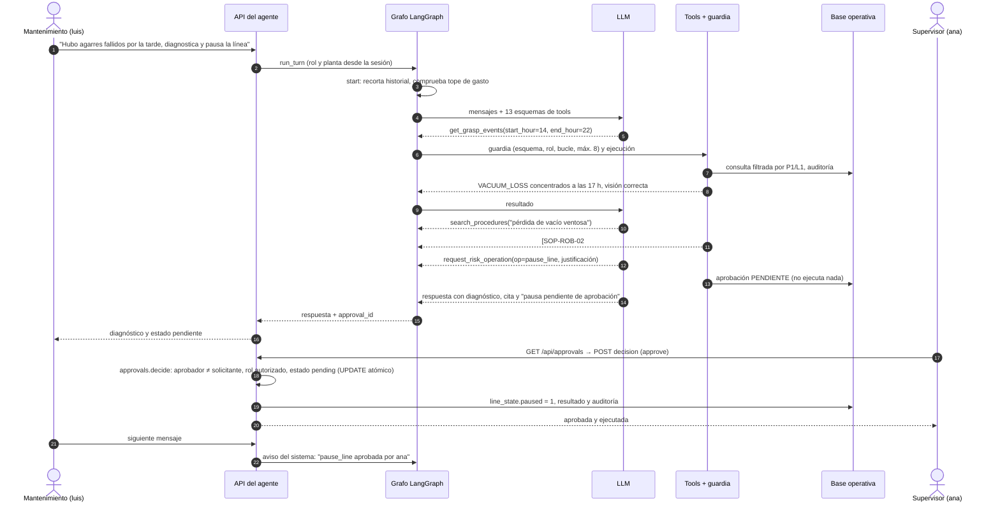

# Arquitectura

El sistema tiene dos mundos separados a propósito. El lazo cámara → visión → robot es código determinista y vive en la planta: decide en milisegundos, siempre igual ante la misma imagen, y sigue funcionando si se cae internet o el LLM. El asistente agéntico vive fuera de ese lazo. Consulta, explica y propone, pero toda acción que cambia la línea pasa por permisos en código y por la aprobación de una persona distinta de quien la pidió.

## Componentes

| Componente | Código | Qué hace | Determinista |
|---|---|---|---|
| Servicio de visión | `src/vision/api.py` | API propia: calidad, clase, ángulo, vistas similares, decisión PICK/DIVERT, evaluación aislada de productos nuevos | Sí |
| Modelo clásico | `src/vision/model.py` | Características HSV, HOG, LBP y píxeles; SVM o regresión logística calibrada; ángulo por vecinos del objeto predicho | Sí |
| Política de decisión | `src/vision/policy.py` | Puerta de calidad, puerta de desconocidos y puntuación de agarre con umbral fijo | Sí |
| Simulador de línea | `src/sim/line_sim.py` | 24 h de inspecciones con el modelo real, incidente de cámara a las 3:00 y fallo de ventosa a las 17:00 | Sí (semilla) |
| Agente | `src/agent/graph.py` | LangGraph: un agente de tool-calling con nodos deterministas de guardia, presupuesto y corte | No (solo el nodo `agent`) |
| Tools | `src/agent/tools/` | 13 operaciones con contrato Pydantic, roles, idempotencia y auditoría | Sí |
| Aprobaciones | `src/agent/approvals.py` | Operaciones de riesgo: petición, decisión de otra persona y ejecución | Sí |
| API del agente y chat | `src/agent/api.py` | Sesiones, subida de imágenes, chat, panel de aprobaciones | Sí |
| Base operativa | `src/common/schema.sql` | SQLite en la demo (PostgreSQL en Azure); todas las tablas de línea con `plant_id` y `line_id` | Sí |

## Diagrama de arquitectura

## Flujo 1: imagen → robot

El robot nunca recibe un ángulo "aproximado" sin respaldo: o recibe PICK con una puntuación de agarre que supera el umbral elegido en validación (riesgo de agarre erróneo ≤ 1 %), o recibe DIVERT. Para objetos simétricos recibe el modo `any` (cualquier giro vale) o `mod180`.

## Flujo 2: agente con aprobación humana

Mantenimiento detecta agarres fallidos, el agente diagnostica y pide pausar la línea; el supervisor aprueba desde su sesión.

## Dónde vive cada decisión

| Decisión | Quién la toma | Por qué |
|---|---|---|
| Agarrar o desviar | Política determinista | Latencia de milisegundos, mismo resultado ante la misma imagen, auditable |
| Valor de los umbrales | Validación (código) y aprobación humana para cambiarlos | Un LLM no debe mover el punto de riesgo de la línea |
| Rol y planta del usuario | Sesión del servidor | El texto del mensaje puede mentir |
| Si una operación de riesgo se ejecuta | Otra persona con rol autorizado | Cuatro ojos; el LLM solo puede pedir |
| Qué tools llamar y cómo explicar | LLM | Es donde aporta: preguntas abiertas y diagnósticos de varios pasos |
| Cuándo parar el agente | Guardia y límites en código | Bucles, coste y tiempo acotados |
