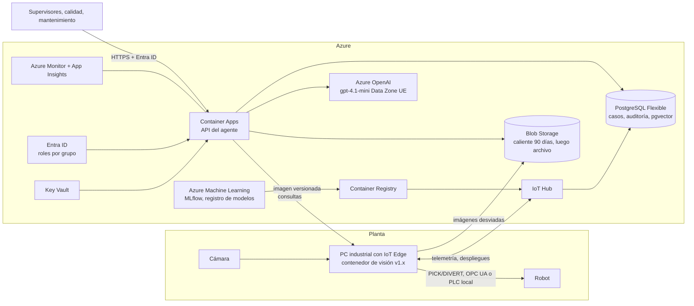

# Arquitectura en Azure y modelo de costos

La demo corre en Docker Compose (local o VPS). Este documento describe cómo iría en Azure para una planta real, con servicios concretos, el porqué de cada uno y su coste. La hoja `costos.xlsx` (generada con `build_costs.py`) tiene los supuestos editables y todas las cifras como fórmulas.

Precios: API pública de precios de Azure, en EUR, consultada el 27 oct 2026. Región West Europe, salvo Azure OpenAI, que se toma de Sweden Central con despliegue Data Zone de la UE.

## Principio: el lazo del robot no depende de la nube

La inferencia de visión corre en un PC industrial junto a la cámara y el robot. Mandar cada imagen a la nube añadiría la latencia de la red al ciclo de agarre, y una caída de internet pararía la línea. La nube se encarga de lo que no es tiempo real: entrenamiento, registro de modelos, asistente, histórico y observabilidad.

## Servicios y trade-offs

| Capa | Servicio elegido | Alternativa descartada | Motivo |
|---|---|---|---|
| Inferencia en planta | Contenedor de visión en PC industrial gestionado con Azure IoT Edge | Inferencia en la nube | Latencia de red en el ciclo del robot y dependencia de internet |
| Gestión de dispositivos | IoT Hub S1 | Event Hubs | Event Hubs ingiere volumen, pero no gestiona dispositivos ni despliega módulos al edge |
| Entrenamiento y registro | Azure Machine Learning | Databricks | El modelo es clásico y pesa pocos MB; AML lee los experimentos de MLflow del repositorio tal cual |
| Agente | Container Apps | AKS | AKS da más control pero obliga a operar un clúster para un servicio pequeño |
| Agente | Container Apps | App Service | Container Apps escala por eventos y comparte el mismo contenedor que la demo |
| LLM | Azure OpenAI gpt-4.1-mini, Data Zone UE | OpenAI directo | Residencia de datos en la UE, red privada y facturación en la misma suscripción |
| Datos operativos | PostgreSQL Flexible Server | Cosmos DB | Los datos son relacionales (casos, tickets, aprobaciones, auditoría) y la demo ya usa SQL |
| Búsqueda en SOP | pgvector en el mismo PostgreSQL | Azure AI Search | AI Search Basic cuesta unos 65 € al mes fijos; con decenas de manuales no compensa. Se cambia cuando el corpus crezca |
| Imágenes | Blob Storage con ciclo de vida | Guardar en la base de datos | 17,8 GB al mes con los supuestos; caliente 90 días y luego archivo (0,0016 €/GB-mes frente a 0,0172) |
| Identidad | Entra ID con roles por grupo | Selección de rol en pantalla (demo) | Cierra el riesgo aceptado de la demo: identidad real para la regla de cuatro ojos |
| Secretos | Key Vault con identidades administradas | Variables de entorno | Sin claves en contenedores |
| Observabilidad | Azure Monitor y Application Insights | Herramientas externas | Trazas del agente, tokens por consulta y latencia en un sitio |

## Coste mensual (supuestos por defecto, una estación)

| Servicio | EUR/mes | Cálculo |
|---|---|---|
| PC industrial (amortización) | 55,6 | 2.000 € en 36 meses |
| IoT Hub S1 | 22,0 | 1 unidad |
| Container Apps (agente) | 124,7 | 1 vCPU y 2 GiB 24x7 en plan Dedicated (cota superior; en Consumption el primer tramo sale a 0 € en la API) |
| Azure OpenAI gpt-4.1-mini | 12,6 | 200 consultas/día, 6.000 tokens de entrada (mitad en caché) y 400 de salida |
| PostgreSQL Flexible B1MS | 16,6 | 730 h más 32 GB |
| Blob Storage | 1,3 | 623.520 imágenes al mes de 30 KB |
| Azure ML (cómputo de entrenamiento) | 2,0 | 10 h de D4s v5 |
| Container Registry Basic | 4,4 | 30 días |
| Key Vault | 0,3 | operaciones |
| Log Analytics | 13,2 | 5 GB |
| Total | ≈ 253 | |

Comparación con la operación actual, con supuestos editables en la hoja:

| Concepto | EUR/mes |
|---|---|
| Hoy: 3 operarios por estación (30.000 €/año cargados cada uno) | 7.500 |
| Sistema: Azure más edge | ≈ 253 |
| Sistema: revisión manual del 10 % de piezas desviadas (10 s cada una, 173 h al mes) | ≈ 2.706 |
| Ahorro | ≈ 4.540 |
| Recuperación de una implantación de 40.000 € | ≈ 9 meses |

La palanca principal no es la nube sino la tasa de desvío. Con un 20 % de desvíos, la revisión manual se duplica y el ahorro baja a unos 1.800 € al mes. Por eso el punto de trabajo de la política (riesgo ≤ 1 %) y el reentrenamiento con las etiquetas de la cola de revisión pesan más en el caso de negocio que elegir entre servicios de Azure.

Lo que más cuesta en la nube es el agente siempre encendido. Con Container Apps en Consumption y escalado a cero fuera de turno, esa partida baja mucho. El LLM es una fracción menor: unos 0,002 € por consulta con los tokens medidos.

## Equivalencia en AWS

El índice del enunciado menciona "Azure vs AWS". Esta es la correspondencia de servicios (sin precios de AWS; no se consultaron):

| Función | Azure | AWS |
|---|---|---|
| Inferencia en planta | IoT Edge | IoT Greengrass |
| Gestión de dispositivos | IoT Hub | IoT Core |
| Entrenamiento y registro | Azure Machine Learning | SageMaker |
| Contenedor del agente | Container Apps | App Runner o ECS Fargate |
| LLM | Azure OpenAI | Bedrock |
| Base relacional | PostgreSQL Flexible Server | RDS for PostgreSQL |
| Imágenes | Blob Storage | S3 con ciclo de vida a Glacier |
| Identidad | Entra ID | IAM Identity Center |
| Secretos | Key Vault | Secrets Manager |
| Observabilidad | Azure Monitor | CloudWatch |

La arquitectura no cambia de forma: edge para el lazo del robot, servicio gestionado de contenedores para el agente y PostgreSQL con pgvector. La elección entre nubes la decide más el contrato del cliente y dónde vive su identidad corporativa que el precio de estos servicios, que es pequeño frente al coste de personal.
