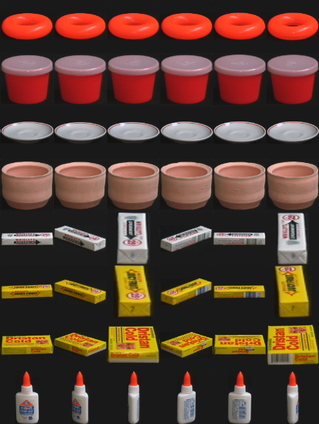
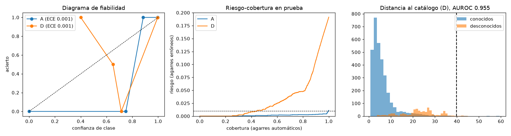

# Resumen

El modelo productivo es una regresión logística sobre histograma HSV, LBP y píxeles reducidos para la clase, más búsqueda de vecinos entre las vistas del objeto predicho para el ángulo. La decisión para el robot la toma una política determinista con una puntuación de agarre calibrada.

Con vistas de referencia cada 10° (protocolo A) acierta el producto en el 99,9 % de las vistas nuevas y deja el 99,0 % de los ángulos dentro de la tolerancia del robot (±10°, teniendo en cuenta la simetría). Con el umbral elegido solo en validación, el robot actúa solo en el 50,7 % de las piezas con un 0,11 % de agarres erróneos; el resto va a revisión. Los 10 objetos desconocidos del protocolo D se rechazan siempre (0 % aceptados, AUROC de la distancia al catálogo 0,955).

Los límites aparecen donde deben: en el arco ciego de 60° (protocolo B) el ángulo solo acierta el 37,8 % y en la escasez de vistas cada 30° (protocolo C) el 76,3 %. En B el sistema rechaza casi todo (cobertura 9,8 %); en C la confianza aprendida con validación no transfiere bien (9,4 % de agarres erróneos entre los aceptados) y la conclusión operativa es no admitir productos con menos de una vista cada 15°.

# 1. Dataset y qué condiciona el diseño

COIL-100: 7.200 imágenes RGB de 128×128, 100 objetos, 72 vistas por objeto cada 5°. ZIP oficial de Columbia CAVE, SHA-256 `fcb4b8b0…4afe7`, con manifiesto por imagen en `data/manifest.csv`.

| Propiedad | Consecuencia |
|---|---|
| El objeto gira sobre una plataforma: rotación fuera del plano | El ángulo no se obtiene girando la imagen; se aprende por objeto (vecinos entre sus vistas de referencia) |
| El ángulo es circular | Error `min(|a−b|, 360−|a−b|)`; media y dispersión circulares |
| Hay objetos simétricos | en el modelo desplegado, 7 simétricos totales y 16 cada 180° (detectados con las vistas de entrenamiento); el robot recibe `any` o `mod180` y el error se mide con simetría |
| Fondo negro, luz fija, una elevación | Control de calidad previo (desenfoque, exposición, fracción de objeto); en planta haría falta segmentación |
| Vistas cada 5° | Con referencias cada 10°, el vecino correcto queda a ≤ 5°: la tolerancia de ±10° es alcanzable; con cada 30°, no |

# 2. Metodología

**Protocolos.** A (entrenar en 0°, 10°…; probar en 5°, 15°…), B (excluir un arco contiguo de 60° por objeto), C (una vista cada 30°), D (90 objetos; probar en vistas intermedias de los 90 y en los 10 excluidos completos).

**Validación sin tocar la prueba.** Cada protocolo tiene una validación interna que imita su salto usando solo vistas de entrenamiento: A y D entrenan en múltiplos de 20° y validan en los intermedios (D además aparta 10 conocidos como desconocidos simulados); B aparta otro arco de 60° dentro de lo visto; C deja una vista fuera en 12 folds. Hiperparámetros, configuración y umbrales se eligen solo con esas métricas. La prueba se evalúa una vez.

**Características.** Clase: combinaciones de histograma HSV (casi invariante al giro), HOG, LBP y píxeles 32×32; estandarización y PCA a 128 componentes. Ángulo: HOG más píxeles (cambian con el giro), solo entre las vistas del objeto predicho.

**Clasificadores comparados.** k vecinos, SVM RBF, Random Forest y regresión logística, con 3 combinaciones de características cada uno (12 configuraciones), más un baseline (1 vecino sobre píxeles) y una referencia moderna (ResNet-50 preentrenada en ImageNet como extractor, con cabezal kNN o logístico).

**Confianza y rechazo.** La clase la decide el clasificador; su confianza se recalibra con regresión isotónica sobre predicciones fuera de fold (folds barajados). La política combina en una regresión logística la confianza de clase, la distancia al catálogo, la incertidumbre del ángulo y la simetría para estimar la probabilidad de agarre correcto, y elige el umbral con la curva riesgo-cobertura en validación (riesgo ≤ 1 %). Antes hay una puerta de desconocidos (distancia por encima del percentil 99 de los conocidos).

**Criterio de aceptación.** Un agarre es correcto si la clase es correcta y el error angular con simetría es ≤ 10°. Cifras de negocio: cobertura (piezas que el robot toma sin persona) y tasa de agarre erróneo entre las aceptadas.

**Trazabilidad.** 60 ejecuciones del barrido y 12 de ángulo registradas en MLflow (`mlruns/mlflow.db`) con parámetros, SHA-256 de datos, métricas, umbrales y predicciones de prueba; resumen en `eval/vision_summary.csv`.

# 3. Selección del modelo

Criterio en validación: media en A-D de (cobertura − 10 × agarre erróneo). Gana la regresión logística con HSV + LBP + píxeles (0,061), seguida de la logística con HSV + HOG (0,028) y Random Forest con HSV + HOG (0,012). Las SVM aciertan la clase igual de bien en prueba, pero en validación aceptan más agarres erróneos y quedan por detrás.

# 4. Resultados por protocolo (mejor clásico)

| Protocolo | Acierto de clase | Ángulo ±10° (crudo) | Ángulo ±10° (simetría) | Error mediano | ECE | Cobertura | Agarre erróneo |
|---|---|---|---|---|---|---|---|
| A interpolación | 99,9 % | 83,4 % | 99,0 % | 0,3° | 0,0008 | 50,7 % | 0,11 % |
| B sector ciego | 96,0 % | 21,8 % | 37,8 % | 17,2° | 0,0315 | 9,8 % | 1,71 % |
| C escasez | 98,8 % | 61,6 % | 76,3 % | 5,0° | 0,0093 | 20,2 % | 9,41 % |
| D desconocidos | 99,9 % (conocidos) | 82,7 % | 98,9 % | 0,3° | 0,0006 | 16,2 % | 0,00 % |

En D, con el umbral de validación, se aceptan el 0 % de las vistas de objetos desconocidos; la AUROC de la distancia al catálogo para separar conocidos de desconocidos es 0,955.

**Por qué la cobertura es baja con el umbral de validación.** La validación es más pesimista que la prueba: sus vistas quedan a 10° de la referencia más cercana, mientras que en prueba quedan a 5°. Exigir riesgo ≤ 1 % en validación da un umbral conservador. Con el umbral elegido para riesgo ≤ 2 % la cobertura en A sube al 96,3 % con 0,43 % de agarres erróneos, pero en D llega al 82,0 % con 5,2 % de erróneos porque empiezan a colarse objetos desconocidos. Por eso el punto de trabajo del protocolo se mantiene en 1 % y el artefacto desplegado se recalibra (sección 7).

# 5. Comparación obligatoria: baseline, mejor clásico y referencia moderna

| Protocolo | Modelo | Acierto de clase | Ángulo ±10° (simetría) | Cobertura | Agarre erróneo |
|---|---|---|---|---|---|
| A | Baseline 1 vecino, píxeles | 96,6 % | 97,6 % | 9,9 % | 0,00 % |
| A | Mejor clásico | 99,9 % | 99,0 % | 50,7 % | 0,11 % |
| A | ResNet-50 + logística | 100,0 % | 80,9 % | 6,4 % | 2,16 % |
| B | Baseline | 78,4 % | 47,2 % | 9,5 % | 0,00 % |
| B | Mejor clásico | 96,0 % | 37,8 % | 9,8 % | 1,71 % |
| B | ResNet-50 + logística | 98,8 % | 13,4 % | 3,0 % | 0,00 % |
| C | Baseline | 83,3 % | 72,8 % | 6,6 % | 22,42 % |
| C | Mejor clásico | 98,8 % | 76,3 % | 20,2 % | 9,41 % |
| C | ResNet-50 + logística | 99,9 % | 41,2 % | 4,0 % | 0,00 % |
| D | Baseline | 96,7 % | 97,6 % | 1,7 % | 0,00 % |
| D | Mejor clásico | 99,9 % | 98,9 % | 16,2 % | 0,00 % |
| D | ResNet-50 + logística | 100,0 % | 79,9 % | 1,8 % | 0,00 % |

Latencia en CPU por imagen: el clásico tarda unos 8 ms (6,4 ms de características y 1,4 ms de predicción); ResNet-50 tarda 73,5 ms en lotes de 64 y más de 0,5 s imagen a imagen en este equipo. El modelo clásico pesa 6,9 MB; ResNet-50, unos 100 MB de pesos.

**¿Justifica la brecha su coste?** No. La referencia moderna gana algo de acierto de clase donde faltan vistas (B: 98,8 % frente a 96,0 %; C: 99,9 % frente a 98,8 %), pero sus embeddings son casi invariantes a la pose, así que el ángulo empeora mucho (81 % frente a 99 % en A) y la cobertura útil se hunde. Para este problema, donde el ángulo es la mitad de la tarea, cuesta 10 veces más latencia y una GPU o un PC más potente en planta sin mejorar el resultado que importa. Una vía razonable sería un híbrido: embeddings modernos solo para la clase en productos con pocas vistas y el ángulo con características clásicas; queda como trabajo futuro.

# 6. Ángulo: vecinos frente a kernel ridge

| Método | Validación (puntuación media A-D) | Ángulo ±10° A | B | C | D |
|---|---|---|---|---|---|
| kernel_ridge-k3 | 0.074 | 99,1 % | 47,9 % | 83,3 % | 98,9 % |
| knn-k1 | 0.059 | 99,4 % | 46,5 % | 73,4 % | 99,4 % |
| knn-k5 | 0.023 | 90,0 % | 28,6 % | 40,7 % | 89,9 % |
| knn-k2 (barrido) | 0.061 | 99,0 % | 37,8 % | 76,3 % | 98,9 % |

Gana kernel ridge en validación (0,074 frente a 0,061 de vecinos con k=2): interpola mejor entre vistas de referencia y su incertidumbre (norma del vector seno-coseno predicho) separa algo mejor los ángulos dudosos. Es el método del artefacto desplegado.

# 7. Calibración del artefacto desplegado

El artefacto v1.0.0 se entrena con la partición D (90 productos, vistas cada 10°): los 10 excluidos siguen siendo desconocidos de verdad para la demo. Su punto de trabajo se recalibra con las vistas intermedias a 5° y los 10 desconocidos, que se parecen más a la operación que la validación interna (vistas a 10°). En ese conjunto de calibración: el robot actúa en el 90,0 % de las piezas de productos conocidos con un 0,9 % de agarres erróneos y acepta el 11,1 % de las vistas de desconocidos (puerta de distancia en el percentil 90, meta de riesgo 1,5 %, 2 % de piezas desconocidas supuesto). Cómo se eligió ese punto (conjunto de calibración, 2 % de piezas desconocidas supuesto):

| Puerta de distancia (percentil de conocidos) | Meta de riesgo | Cobertura de conocidos | Agarre erróneo en conocidos | Vistas de desconocidos aceptadas |
|---|---|---|---|---|
| 99 | 1,0 % | 29,5 % | 1,05 % | 0,0 % |
| 99 | 1,5 % | 98,7 % | 1,06 % | 21,4 % |
| 95 | 1,5 % | 95,0 % | 0,94 % | 22,1 % |
| 90 | 1,5 % | 90,0 % | 0,93 % | 11,1 % |
| 85 | 1,5 % | 85,0 % | 0,91 % | 5,7 % |

El error en conocidos se queda en torno al 1 % con cualquier umbral: son ángulos equivocados con mucha confianza que la puntuación no separa (por eso el umbral de la puntuación desplegado queda en 0,009 y quien filtra es la puerta de distancia). Lo que sí se controla es cuántos desconocidos se cuelan. Un producto equivocado empacado es peor que un agarre fallido, así que se elige el percentil 90: 90 % de cobertura y, con un 2 % de piezas desconocidas, un 0,25 % de piezas con producto equivocado. Es una decisión de negocio que la hoja de costos permite revisar.

Estas cifras son dentro de muestra y optimistas; el despliegue real empezaría en modo sombra (el sistema decide, la persona sigue alineando) para medir cobertura y error antes de retirar la tarea manual.

# 8. Análisis de errores

- **Confusiones de clase**: se concentran en pares de objetos casi idénticos en color y forma (envases del mismo fabricante con distinto rótulo). La clase es el problema menor: 99,9 % en A.
- **Ángulo**: los errores grandes se concentran en objetos casi simétricos que no pasan el umbral de simetría (frascos con etiqueta pequeña) y dan saltos de unos 180°. La métrica con simetría lo corrige para los detectados; los que quedan cerca del umbral son el principal riesgo.
- **Arco ciego (B)**: el error crece hacia el centro del arco; en los extremos el vecino más cercano está a 5-10°, en el centro a 30°. La puerta de confianza rechaza la mayoría: es el comportamiento buscado, no un fallo.
- **Escasez (C)**: con referencias cada 30° el vecino correcto puede estar a 15°; el error mediano sube y la validación dejando una vista fuera (vecinos a 30°) no predice bien la prueba, así que el umbral deja pasar agarres erróneos.
- **Robustez**: con desenfoque o ruido el acierto baja; el control de calidad desvía esas imágenes antes de la política (en la demo, el incidente de cámara de las 3:00).

# 9. Model card

Ver `models/vision/v1.0.0/MODEL_CARD.md` (incluido a continuación).

MODEL_CARD_INLINE
